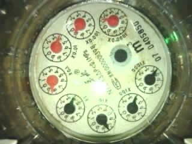
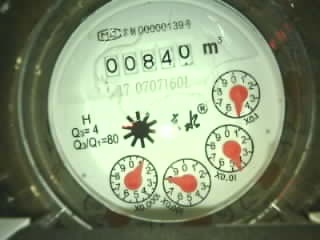
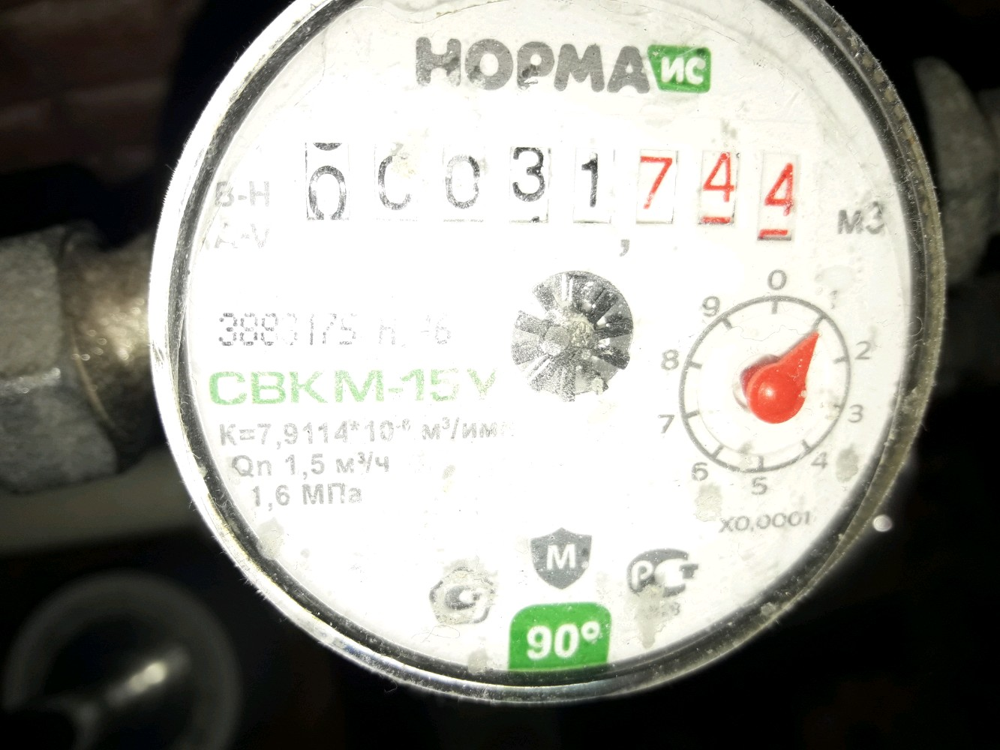
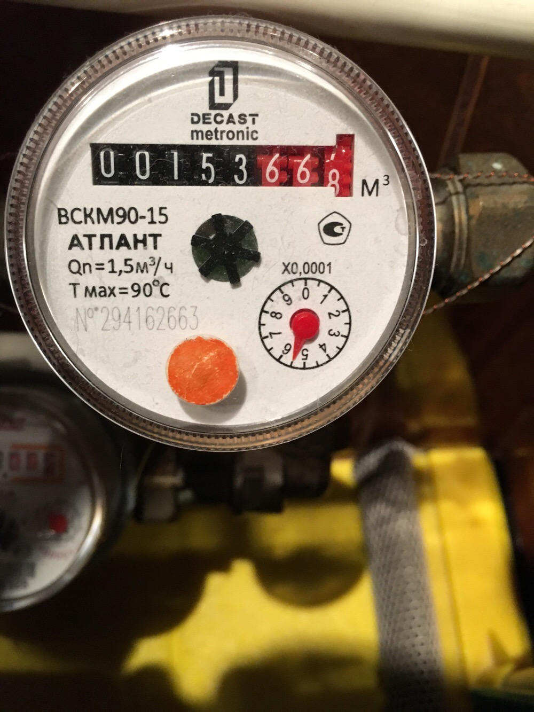

# WaterMeter AI — 水表识别 API 与实用工具

[English](README.md) | **简体中文**

水表识别 API 官方调用示例，支持 curl、Python、Node.js、Java、.NET、Go、PHP 和 PowerShell。

**欢迎访问[水表识别官网 watermeterai.com](https://watermeterai.com/zh-cn)。** 先在浏览器中体验水表识别，再使用同一账号接入自己的应用、图片转 CSV 工具、Home Assistant 或手机客户端。

**在官网免费获取 API Key。** [免费注册](https://watermeterai.com/zh-cn/login?flow=register)并登录后，即可[免费创建 API Key](https://watermeterai.com/zh-cn/api-keys)。普通免费账号每天可识别 **20 次**，与官网及所有 API 客户端共用额度，未用完不累积；付费、自定义及合作账号按实际额度政策执行。接入方式见[中文 API 文档](https://watermeterai.com/zh-cn/api-docs)。

下列客户端均为**测试预览版**。[下载图片转 CSV 和 Home Assistant 预览包](https://github.com/tankfly2024/water-meter-ai-api-examples/releases/tag/preview-20261121-r1)，手机端下载见下方介绍。真实 Home Assistant 安装、手机真机及生产 API 完整识别流程仍需补验。

- 官网：https://watermeterai.com/zh-cn
- API 文档：https://watermeterai.com/zh-cn/api-docs
- API Key 管理：https://watermeterai.com/zh-cn/api-keys

你可以通过本仓库，在自己的应用中验证图片上传、任务查询、额度查询及公开 AI 服务状态查询。

## 水表照片与读数示例

以下照片已在[水表识别官网 watermeterai.com](https://watermeterai.com/zh-cn)展示，包含指针表及不同形式的机械字轮表。**下方读数为人工标注的参考值，本次制作展示未运行新的 AI 推理。** 点击照片可查看原图。

<table>
  <tr>
    <td align="center" valign="top" width="50%">
      <p><strong>1. 多指针水表</strong></p>
      <a href="assets/website-examples/pointer-4373.jpg"></a>
      <p><strong>参考读数：<code>4373 m³</code></strong><br>按整数立方米展示</p>
    </td>
    <td align="center" valign="top" width="50%">
      <p><strong>2. 字轮与指针组合表</strong></p>
      <a href="assets/website-examples/combined-00840.jpg"></a>
      <p><strong>参考读数：<code>00840 m³</code></strong><br>按整数立方米展示</p>
    </td>
  </tr>
  <tr>
    <td align="center" valign="top" width="50%">
      <p><strong>3. 浅色字轮水表</strong></p>
      <a href="assets/website-examples/light-register-00031-744.jpg"></a>
      <p><strong>参考读数：<code>00031.744 m³</code></strong><br>字轮读数保留三位小数</p>
    </td>
    <td align="center" valign="top" width="50%">
      <p><strong>4. 黑红字轮水表</strong></p>
      <a href="assets/website-examples/mechanical-register-00153-668.jpg"></a>
      <p><strong>参考读数：<code>00153.668 m³</code></strong><br>字轮读数保留三位小数</p>
    </td>
  </tr>
</table>

照片本身保持原样。读数沿用官网示例的展示精度并保留前导零；整数示例不展开小数分度指针。你可以[前往官网上传自己的照片体验识别](https://watermeterai.com/zh-cn)，或[免费获取 API Key](https://watermeterai.com/zh-cn/api-keys)接入应用。

## 仓库用途

本仓库提供水表 API 示例与官网入口，帮助开发者在 GitHub 上了解服务、运行示例，并继续到官网体验和接入。

仓库仅包含公开 API 客户端示例，不包含 AI 服务源码、调度源码、网站后端源码、模型、私有接口、部署细节或内部架构。

## 图片转 CSV 客户端

[WaterMeter Image-to-CSV 图片转 CSV 工具](examples/python/image_to_csv/README.zh-CN.md)提供在用户本机运行的浏览器界面，支持导入图片、API 识别、人工复核和 CSV 导出。没有 API Key 也可以使用离线演示。目前本地原型已完成模拟 API 流程测试，真实生产识别接入仍待核验。

## Home Assistant 集成

需要将摄像头画面转换为水表读数传感器时，可以使用 [WaterMeter AI Home Assistant 自定义集成](examples/home_assistant/README.zh-CN.md)。本地原型支持手动识别、累计读数、人工复核和额度显示。真实 Home Assistant 安装及生产 API 识别仍待验证；说明中提供了手工安装步骤和可选自动化示例。

## 手机客户端预览

[WaterMeter Mobile 手机项目](examples/flutter/watermeter_mobile/README.zh-CN.md)使用一套源码覆盖安卓和苹果，支持拍照、选图和读数复核，并提供醒目的官网及免费 API Key 入口。[下载安卓测试 APK、iPhone 模拟器应用和完整源码](https://github.com/tankfly2024/water-meter-ai-api-examples/releases/tag/mobile-preview-20261121-6475f37)。[云端构建流程](https://github.com/tankfly2024/water-meter-ai-api-examples/actions/runs/44896315554)已完成两端编译、两端各 19 项应用测试，以及一项模拟 API 的 iPhone 模拟器交互流程。手机真机和生产 API 识别仍需单独验证。苹果包供 Mac 上的模拟器运行，不能直接安装到 iPhone。

下图为实际模拟器界面：**离线演示使用示意图和预设读数，不调用生产识别 API。** [查看英文截图](https://github.com/tankfly2024/water-meter-ai-api-examples/releases/download/mobile-preview-20261121-6475f37/demo-en.png)。


## 快速开始

1. 在 https://watermeterai.com/zh-cn 登录账号。
2. 在 https://watermeterai.com/zh-cn/api-keys 创建 API Key。
3. 将 `.env.example` 复制为 `.env`，填写以下配置：

```text
WATERMETER_API_BASE=https://watermeterai.com
WATERMETER_API_KEY=wm_xxxxxxxxxxxxxxxxx
IMAGE_PATH=./sample-images/example.jpg
```

4. 将本地测试图片放到 `IMAGE_PATH` 指定的位置。
5. 运行下面任意一种调用示例。

## API 调用流程

示例只调用以下公开 API：

- `GET /api/open/ai-status`
- `GET /api/open/quota`
- `POST /api/open/tasks`
- `GET /api/open/tasks/{task_id}`

每个示例上传一张图片，保存返回的 `task_id`，轮询到任务状态为 `done` 或 `failed`，然后输出最终结果。

## 运行示例

### curl

需要安装 `curl` 和 `jq`。

```bash
cd examples/curl
chmod +x single-task.sh
./single-task.sh
```

### Python

```bash
cd examples/python
python -m pip install -r requirements.txt
python recognize.py
```

### Node.js

需要 Node.js 18 或更新版本。

```bash
cd examples/node
npm install
npm start
```

### Java

需要 JDK 11 或更新版本。

```bash
cd examples/java
javac Recognize.java
java Recognize
```

### .NET

需要 .NET 8 SDK 或更新版本。

```bash
cd examples/dotnet
dotnet run
```

### Go

```bash
cd examples/go
go run .
```

### PHP

需要 PHP，并启用 curl 扩展。

```bash
cd examples/php
php recognize.php
```

### PowerShell

需要 PowerShell 7。

```powershell
cd examples/powershell
pwsh ./recognize.ps1
```

## 常见 HTTP 错误

- `401`：缺少 API Key，或 Key 无效。
- `413`：图片文件过大。
- `415`：不支持该图片类型或文件内容。
- `429`：可用额度已耗尽。

## 安全说明

- 不要提交 `.env` 文件。
- 不要提交真实 API Key 或令牌。
- 不要调用私有后端、调度或 AI 服务接口。
- 服务端程序应在服务器上保存 API Key，不要将其暴露在浏览器 JavaScript 中。

## 开源许可

本仓库采用 MIT 许可证，可以复制这些示例，并根据自己的应用需要进行修改。

## 建议的 GitHub 仓库信息

仓库简介可使用以下英文描述，便于开发者搜索：

```text
Water Meter Recognition API examples for curl, Python, Node.js, Java, .NET, Go, PHP, PowerShell, Postman, and OpenAPI.
```

建议使用以下主题标签：

```text
water-meter, meter-reading, image-recognition, computer-vision, ai-api, api-examples, python, nodejs, java, dotnet, go, php, postman, openapi
```
